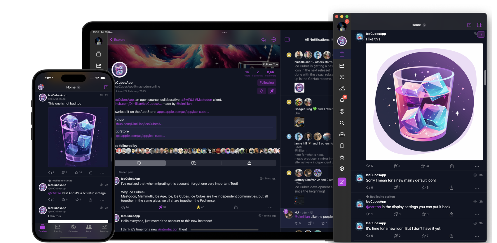
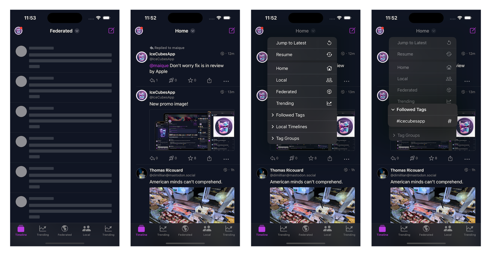
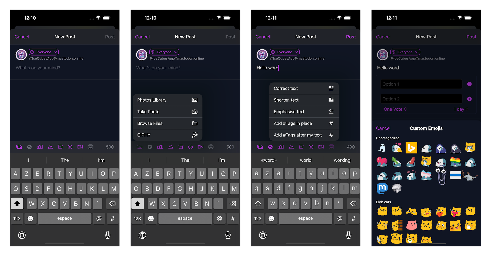
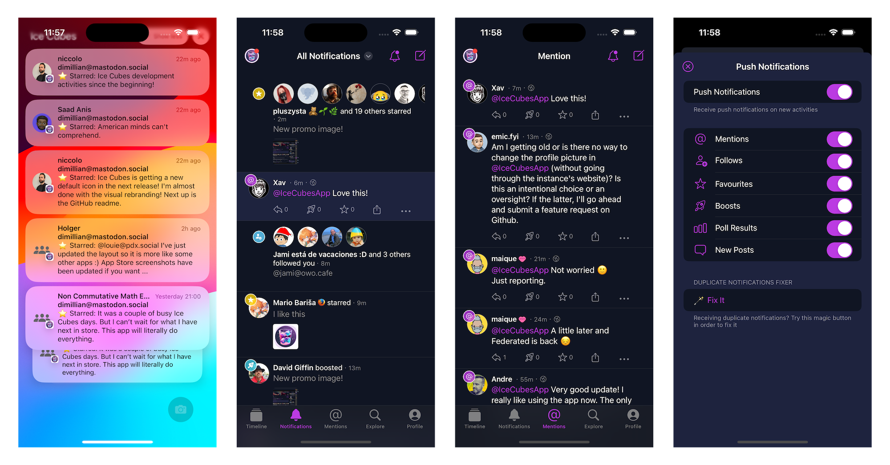
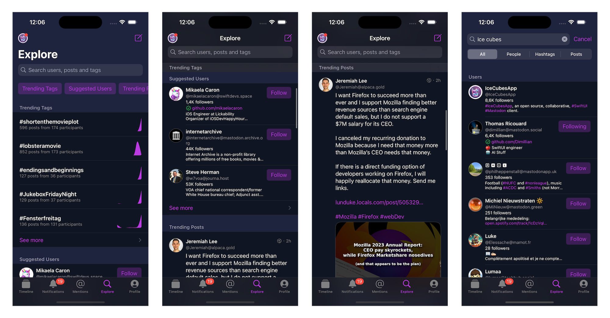
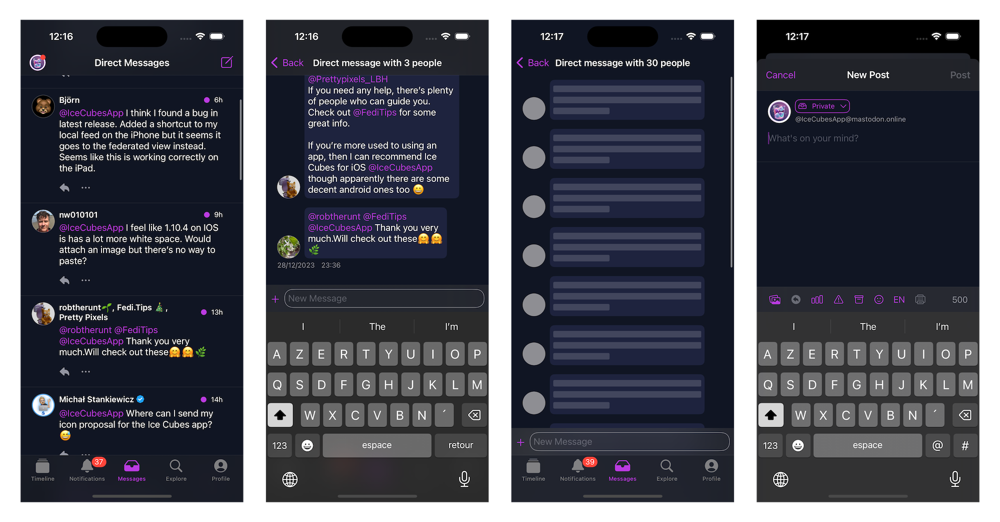
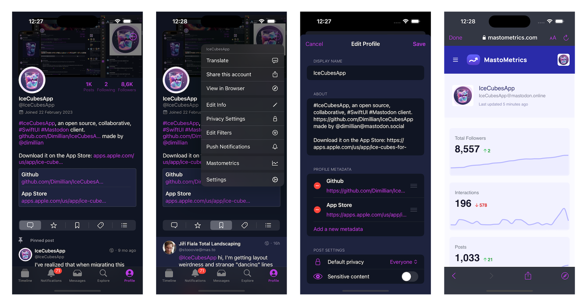
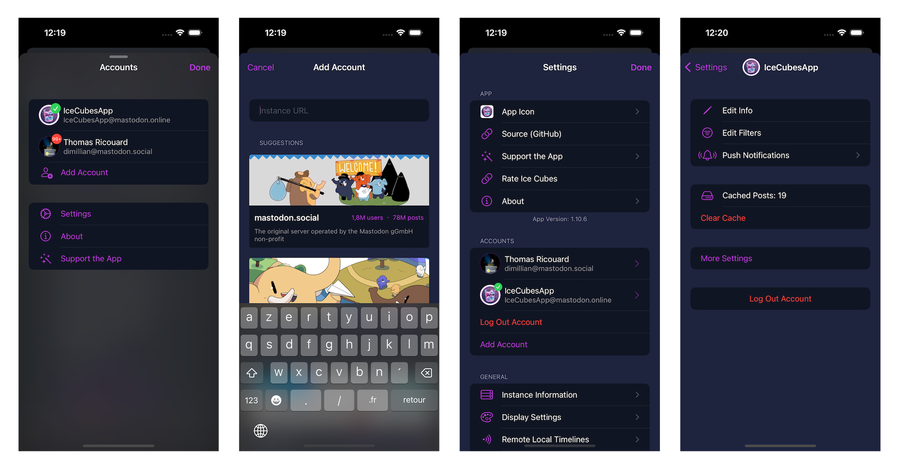
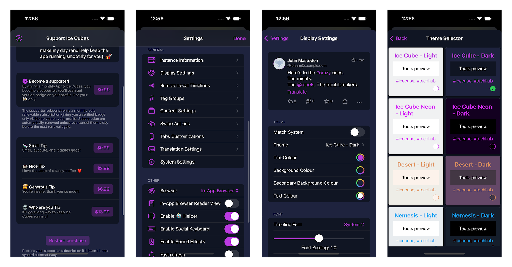
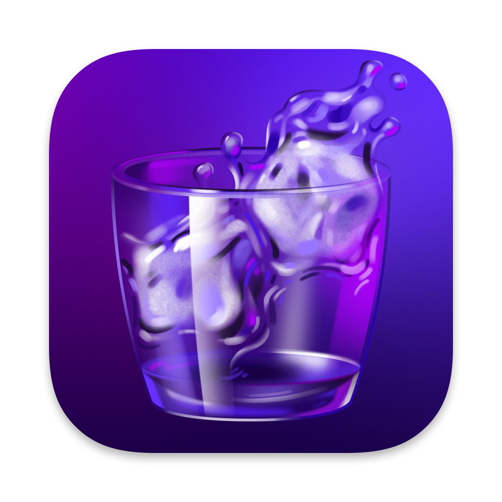

# IceCubesApp

[](https://apps.apple.com/us/app/ice-cubes-for-mastodon/id6444915884)

<a href="https://www.emergetools.com/app/example/ios/com.thomasricouard.IceCubesApp/release?utm_campaign=badge-data"></a>
<a href="" rel="nofollow"></a>
[](https://www.gnu.org/licenses/agpl-3.0)



IceCubesApp is an open-source application for accessing the decentralized social network Mastodon! It's built entirely in SwiftUI, making it fast, lightweight, and easy to use.

You can connect to any Mastodon instance, browse your timeline, interact with other users, and post updates and media.

It's multiplatform and works on iOS, macOS, iPadOS, and visionOS.
It has a dedicated UI with a sidebar on macOS and iPadOS.

## Features

### Timeline



* A navigation bar title menu lets you easily swap between your home, local, federated, and trending timeline.
* You can also easily access your lists, followed tags, and tag groups.
* Tag groups are custom timelines made of multiple tags, a feature unique to Ice Cubes.
* Quote post!
* You can also add a remote local timeline. A helpful feature to browse the public timeline of other instances. Another Ice Cubes only feature.
* Ice Cubes relies heavily on the streaming events of Mastodon to do stuff like showing new posts live in the home timeline and editing and deleting your posts.
* The timeline sync is semi-automatic; your position is sent to the Mastodon marker API, and from another device running Ice Cubes, you can resume your home timeline position.
* The home timeline is cached using the third-party library [Bodega](https://github.com/mergesort/Bodega). A lite SQLite wrappers. The current position is saved in user default, so when you switch accounts or launch the app, your cached home timeline and position are restored. Then new posts will be fetched and displayed with an unread counter.
* Server side filters support.
* Create and switch to your lists.

`Code` -> Status & Timeline package

### Editor / Composer



* Full-featured post editor.
* You can write threads up to 5 posts.
* Upload up to 4 images.
* AI-assisted tools using OpenAI API for text correction, hashtag generation, and more.
* Generate image description using AI!
* Custom emojis support.
* Add polls and content warnings.
* Save/restore from drafts.
* Use the Apple language detection feature to suggest the language before posting.

`Code` -> Status package -> StatusEditor component
`Code` -> OpenAIClient

### Notifications



* Notifications are fetched and grouped in-app, like mentions, favorites, boosts, etc...
* Route to the correct post and switch to the proper account when taping notifications.

Push notifications (the APNs proxy, the notification service extension and the per-account
subscription settings) are removed from this fork, so the app builds with a wildcard
provisioning profile that has no `aps-environment` entitlement.


`Code` -> Notifications package.

### Explore / Search



* Dedicated explore/search tab for trending users, tags, posts, and links.
* Easy access to all those categories from the top area.
* You can search for everything or filter by users, tags, and posts.
* See a graph for the activities on the trending tags.
* See more from each category to access the full-screen view.

`Code` -> Explore package

### Direct Messages



* Dedicated tab for direct/private messages.
* Chat like UI
* You can use the inline composer for a quick chat or the full editor.

`Code` -> Conversations package

### Profile



* Rich profile support.
* Fully access & tweak your privacy settings.
* Edit your profile, from your bio to your custom fields.
* Add a custom server-side note visible only to you for any profile.
* Translate the bio of any profile to your language.
* Easy access to edit your server-side timeline filters.
* Easy access to share your profile outside of the app.

`Code` -> Account package

### Multi Accounts



* Support for an unlimited number of Mastodon accounts.
* Easily browse/discover instances and log in!
* Swap account from any screen on iOS.
* Swap your account from the macOS/iPadOS sidebar with just one click.
* Full server-side and client-side account settings support.
* Swipe to delete an account from the settings.
* Safe authentication using Apple's `WebAuthenticationSession`
* The account token is securely stored in the keychain.

`Code` -> Account & AppAcount packages

### Other



* You can support this project with tips in the app and Github sponsoring.
* Massive amount of customization settings.
* You can tweak the display settings like the font, line spacing, status actions buttons, etc...
* Many built-in themes.
* Make your theme.
* Customize your swipe gestures.
* Customize your tabbar entries.
* Sound & haptic feedback support.

## A note on the architecture

The project is split into different Swift Packages to make managing and maintaining the codebase easier. Each package focuses on a specific application aspect, such as the UI, network communication, or data models. This modular approach allows for easier collaboration and ensures the code is organized and easily understood.

It's a great starting point for learning SwiftUI. The app covers many of the basic concepts of SwiftUI, such as building layouts, working with data, and handling user interaction. By exploring the code, you can understand how to use SwiftUI in your daily life. Plus, the open-source nature of IceCubesApp means you can see how real-world applications are built and get a sense of best practices for using SwiftUI.

The architecture is straightforward MVVM for most parts, there is no redux on this one ;)

Thanks!



## 快速开始：注册账号并登录（中文）

### 为什么需要填「服务端 URL」

Ice Cubes 是 Mastodon 客户端，而 Mastodon 是**联邦网络**：没有统一的账号中心，每个账号都隶属于某一台实例（instance）。App 必须先知道你在哪台服务器上，才能拼出所有接口地址（`https://<服务器>/api/v1/...`）、在该实例完成 OAuth 登录，并读取实例配置（字数上限、媒体数量、是否支持翻译等）。

### 第一步：注册一个实例账号

如果还没有账号，挑一个**开放注册**的实例即可，几秒钟就能建好：

| 实例 | 说明 |
|---|---|
| [c7.io](https://c7.io) | 中文社区，开放注册、无需审核，Mastodon 4.7 |
| [kazv.moe](https://kazv.moe) | 中文实例（Pleroma 2.11），需要管理员审核 |
| [mastodon.social](https://mastodon.social) | 最大的实例，生态最全；部分网络环境需要代理才能访问 |

步骤：

1. 用手机或电脑浏览器打开实例首页，点「注册 / Sign up」
2. 填写用户名、邮箱、密码，完成邮件验证
3. 记住你的**实例域名**，例如 `c7.io` —— 下一步要用

> 提示：国内网络直连不了部分实例（`mastodon.social`、`mstdn.jp` 等可能直接连接被重置），优先选你能打开的实例；账号在哪个实例都能关注别人，不必纠结。

### 第二步：在 App 里添加这个实例

1. 打开 Ice Cubes，点「添加账户」
2. 在「服务器 URL」里输入你的**实例域名**（只填域名，不带路径、不带用户名）
3. 点「连接」，App 会先读取实例信息（图标、版本、规则），然后弹出该实例的授权页
4. 在授权页（`https://<你的实例>/oauth/authorize`）登录并点「授权」
5. 自动跳回 Ice Cubes，登录完成，时间线开始加载

输入框对这几种写法都能识别：

| 输入 | 结果 |
|---|---|
| `c7.io` | ✅ 正确 |
| `https://c7.io/` | ✅ 自动去掉协议头和末尾斜杠 |
| `@你的用户名@c7.io` | ✅ 自动截取域名部分 |
| `c7.io/api` | ❌ 不要带路径 |

### 常见问题

- **首次启动提示「允许 Ice Cubes 使用无线数据？」**：请选「无线局域网与蜂窝网络」，选「不允许」会导致时间线、图片、实例列表全部加载失败
- **点「连接」一直转圈或报错**：多半是该实例在你当前网络下不可达，换一个实例试试
- **授权页卡在「Just a moment…」**：实例前面有 Cloudflare 人机验证，等它自动通过即可（在真实浏览器/内嵌 WebView 里正常，命令行访问才会被拦）
- **能登录但时间线是空的**：新账号还没关注任何人，去「探索」或「新闻」里关注几个账号即可

## Building the project

To build the project, you need to clone the repo and create a copy of the included `.xcconfig` file to create your config before you can compile the project. **Otherwise, you will get an error.**

Here are the steps:

1. Clone the repo
2. In the same folder that contains the `IceCubesApp.xcconfig.template`, run this command:

```bash
cp IceCubesApp.xcconfig.template IceCubesApp.xcconfig
```

3. Fill in the `DEVELOPMENT_TEAM` and `BUNDLE_ID_PREFIX` values. The first should have your Apple Team ID (which you can find by logging into the Apple Developer Portal). The latter is your domain in reverse notation or whatever you use as the prefix for your projects.
4. Save your changes, and then you should be able to compile the project without any issues.

## 本分支的改动 / Fork notes

这个分支裁剪掉了需要额外开发者能力或与本机无关的部分，方便用自己的 Team + 通配符描述文件直接构建运行：

- **移除推送通知**：APNs 代理、Notification Service 扩展、逐账号推送订阅与设置全部删除；App 内「通知」标签页保留，进入 App 后从 Mastodon API 拉取
- **移除 iCloud / CloudKit 授权**
- **移除 App Group**：扩展（分享 / 小组件）改为通过 Keychain 共享账号，不再需要共享容器
- **移除全部音效**：按钮点击、下拉刷新、收藏/转发等音效已删除，触感反馈（振动）保留，可在「设置 → 触感反馈」中关闭
- **签名要求**：因为不再有推送 / App Group / iCloud 能力，可以直接使用 `com.*` 通配符描述文件；`BUNDLE_ID_PREFIX` 需保持 `com.` 开头，否则通配符 profile 无法匹配

构建方式与上游一致（见上一节），把 `IceCubesApp.xcconfig` 里的 `DEVELOPMENT_TEAM` 与 `BUNDLE_ID_PREFIX` 换成你自己的即可。
